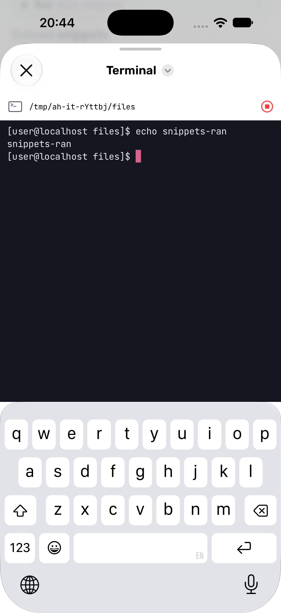

# Attached terminal

A session owns one companion shell on its host, independent of its agent terminal.
The session menu and row context menu open Terminal; iPad shows a side panel and
iPhone a panel sheet. Closing either leaves the shell running. Shell code blocks
and selected transcript text offer Send to terminal, which pastes and runs through
that same attachment. A foreground server or editor returns the host's busy error;
the app never picks another session's shell. Holding a snippet's terminal button
also offers Type in Terminal Without Running (the words selected in a reply: Type
in terminal), which types it at the prompt to look at or change before Return.

While a command runs in the shell, a green dot sits at the terminal glyph's corner:
in session rows, beside the panel's header (with "Running <command>"), on the
panels button in the composer and the iPad header, and on Terminal in the session
and panel menus (its subtitle says what runs).

The panel's header has Send to Chat (a speech bubble), built as it opens from the
host's text of that moment: Last Command and Its Output (named in its subtitle),
Selection (what's selected in this terminal), What's on Screen. Each goes into
the session's box after what's already there, fenced, the caret after it, to say
what it's about before sending; on a phone the panel's sheet goes so the box shows.
A Copy section puts the same text, unfenced, on the clipboard. The host finds the
last command without shell configuration (`../ah/server/terminalCommands.ts`).

The host advertises `features.attachedTerminal: 1`; older hosts don't offer these
controls. Version 2 adds `GET …/terminal/text` (`{ terminal, last, screen }`) and
POST's `run: false`; on a version 1 host Send to Chat offers only the selection,
and snippets only run. `SessionDTO.terminal` and the typed GET/POST/DELETE
`/api/sessions/:uid/terminal` calls share the backend/web contract. The existing
native bearer, peer routing and real SwiftTerm/WebSocket transport are used.
Each reconnect resolves the attachment again. Lookup failures retry without
replaying input. Agent and companion terminal have separate keyboard focus targets,
both tied to the owner uid. The Terminal panel is part of the scene snapshot.

The shell survives ah restarts and viewer disconnects. Explicitly stopping the
terminal, terminating the owner, or forgetting it ends the shell and its processes.
A server started there appears in the owner's Preview port list.

## Verification — 15 November 2026

- Swift 6.2 on Linux: core suite passes; tests cover the DTO, authenticated peer
  requests, distinct focus and panel encoding, retry after failed attachment lookup.
- Three real-host integration tests pass using the project's `it-host.mjs` fixture:
  native enrollment/bearer → owner → attached shell → command → SwiftTerm output;
  scene snippet → owner's panel and focus → hide/reopen → terminate cleanup;
  regression coverage for the agent terminal's existing input/rendering.
- Xcode 27.2 on the MacBook Air: `scripts/verify.sh` completed with **TEST SUCCEEDED**
  (revision `9a98bdd`): Mac Catalyst build, iPhone 18 Pro / iOS 27.0 build,
  268 unit tests and both setup UI tests passed. The 16 host-dependent UI tests
  were skipped in that standard run.
- The dedicated iPhone simulator walk paired with a disposable host and the native
  Send to terminal button ran `echo snippets-ran` in the real attached shell.
  The session menu's TUI entry is named Agent Terminal to distinguish it from
  Terminal, the companion shell.
- The dedicated `AttachedTerminalUITests` test passed in Xcode at revision
  `10d52c2`: fresh pairing → transcript → Send to terminal → shell panel → close
  → session menu → Terminal → reopened shell panel. Host-side verification confirmed
  the snippet output and no extra session row. The fixture and reverse SSH tunnel
  were cleaned up afterward. The blinking cursor makes Xcode wait for animation
  quiescence; the successful run took about 201 seconds.
- Physical-device signing and iPad interaction checks remain separate.
- The repository's `integration.sh` launcher stops before tests at its pre-existing
  API coverage check: 12 routes for usage, interruptions, recovery and capabilities
  lack native paths. The three new terminal routes have native paths. Targeted
  integration tests were run directly with the same disposable host fixture.

The native feature is on the local `feat/session-terminal` stack branch. Its host
requires the backend `feat/session-terminal-api` branch (or a descendant).

