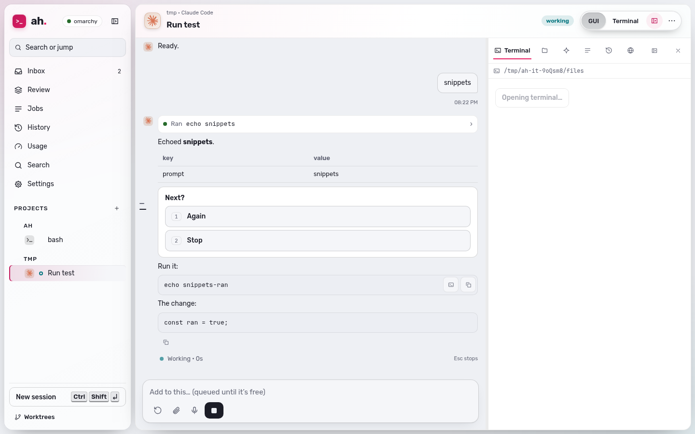
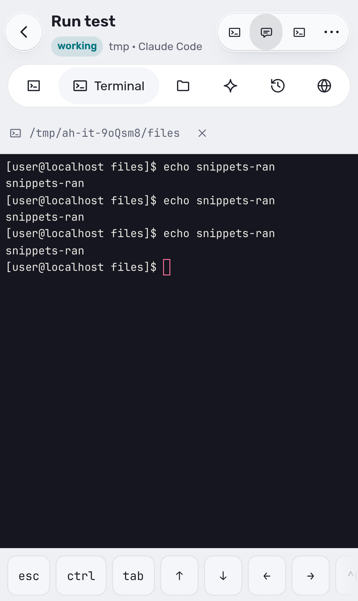

# Attached terminals

Each session can own one companion shell, separate from its agent's GUI and TUI.
Opening or hiding its panel never restarts either process. The shell starts in the
session's current working directory, inherits the configured launch environment,
and lives in tmux across browser, native client, and ah restarts. It has no registry
or history row. Explicitly terminating or forgetting the owner also stops its shell;
closing the panel only detaches the viewer. Servers it runs appear in the owner's Preview.

Hosts advertise `features.attachedTerminal: 2` (1 had no `…/text` and no `run`). Authenticated routes, including
native bearer auth and `/h/:host` peer forwarding, use the existing protections:

- `GET /api/sessions/:uid/terminal` → `{ terminal: null | AttachedTerminal }`.
- `POST /api/sessions/:uid/terminal` with `{}` opens or reuses the shell.
- The same POST with `{ command: string }` pastes the command and presses Enter;
  with `run: false` it is only typed, to look at or change before pressing Return.
  A foreground program returns HTTP 409 with
  `code: "terminal_busy"`; commands are never queued or sent to an unrelated shell.
- `GET /api/sessions/:uid/terminal/text` → `{ terminal, last: null | LastCommand,
  screen: null | string }`, for a client to put in the chat: the newest command run in
  the shell with what it printed, and the visible screen. `LastCommand` is `{ command, line, output, running, truncated }`: `line` is the
  command's line as the terminal shows it (prompt included), `output` runs to the next
  prompt (or, while `running`, to the cursor), its last 400 lines at most.
  ah notes the line of each Return that reaches the shell at its prompt, from any
  viewer or a snippet it ran (`server/terminalCommands.ts`), so no shell configuration
  is needed. A bare Return at an empty prompt is skipped. Those notes are kept in
  memory; after an ah restart, the last earlier line that starts with the current
  prompt is taken instead.
- `DELETE /api/sessions/:uid/terminal` stops the shell and its processes.
- `AttachedTerminal` is `{ id, cwd, command, busy }`; the same value is included as
  each live window's optional `terminal`. `busy` describes the foreground process,
  including a quiet server. Clients show attachment and activity separately from
  the agent's own status.

The existing authenticated `/ws/:id` terminal transport renders the shell. Clients
resolve the attachment again on reconnect so closing and recreating it cannot send
input to an old tmux window. Shell commands must be deliberately selected by the
person using a snippet button; rendering a snippet never executes it.

## Web and native clients

Session menu → Terminal opens the shell. The web app uses a side panel on desktop
and a tab within the owner on a phone. The native app uses a side panel on iPad and
a panel sheet on iPhone, with its own SwiftTerm viewer and keyboard focus. The
terminal icon shows attachment and turns red during foreground work. Send to
terminal beside Copy pastes and runs shell snippets in that attachment.

Verified on 15 November 2026: desktop/phone browser journeys, restart persistence,
concurrent opens, busy refusal, Preview discovery and stopping an attached viewer;
native core tests and real-host SwiftTerm/scene integration tests. The native app
builds and passes its standard checks in Xcode 27.2 on the MacBook Air, and the
attached shell was exercised on an iPhone simulator. Physical-device validation
remains separate.

