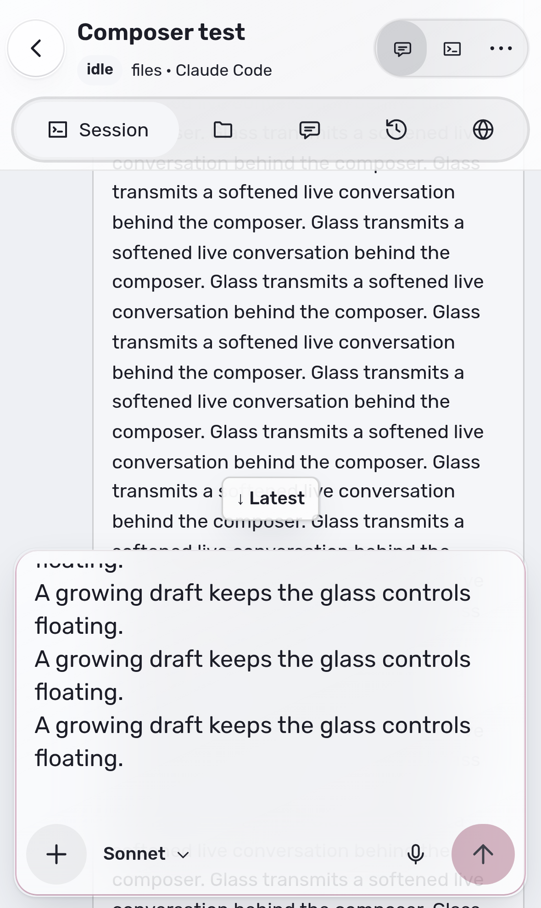
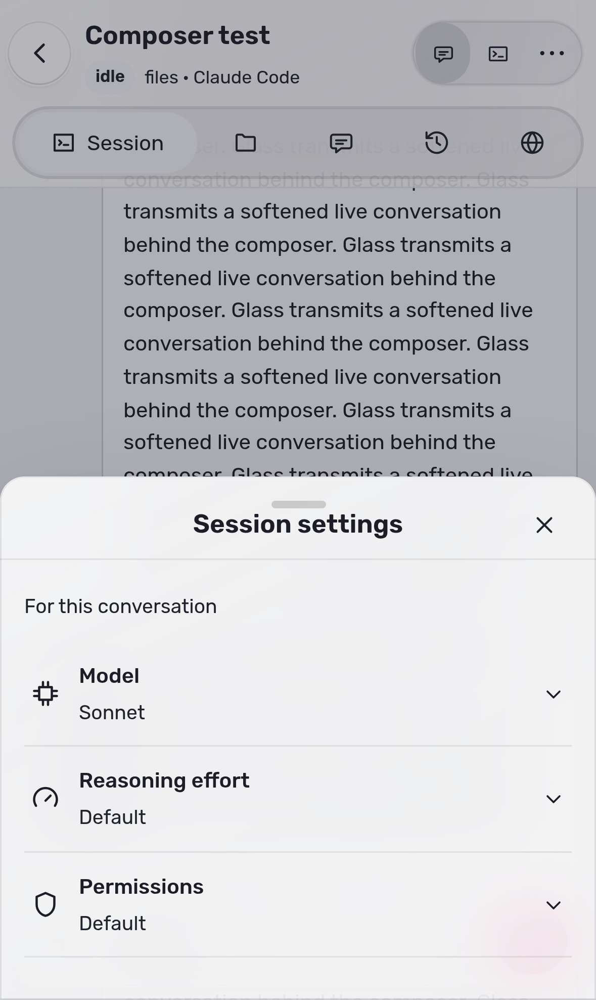

# Web glass materials

The shared glass material filters content behind floating controls. Its tint
and subtle sheen are translucent; inset shadows draw the thin edges. The old
rim gradient used `border-box`, which paints the whole box, so it also sat
under the interior and washed out the backdrop. The sidebar separately used
an opaque fill and had no backdrop filtering.

The material now has three densities: small chrome, sidebar panels, and
reading sheets. Chrome retains color and movement from its backdrop; sheets
use more tint to protect longer text. Secondary labels use stronger ink.
The composer settings sheet shares one backdrop rather than stacking a second
frosted header over it. Conversation text keeps its regular reading ground.

## Mobile conversation

The phone/touch-tablet header and composer now float over the actual feed.
Their backing plates filter the conversation as it scrolls underneath. A
`MobileOverlay` measures each region and reserves matching scroll padding, so
the first and last messages remain readable and a growing draft or queue does
not cover the response. The Latest action stays above the writing surface;
on mobile it lands immediately at the current end, avoiding a smooth-scroll
target becoming stale when the draft or keyboard changes the available space.

Mobile floating chrome uses a lighter tint and stronger blur than desktop
panels, so conversation color and motion show through without making controls
hard to read. Focus on the composer adds a restrained edge and a single glass
rim instead of a double outline.

Bottom-up drawer headers share one translucent bar. Close and Back stay inside
that surface as 44px icon targets instead of appearing as separate glass
bubbles.

The mobile conversation opts out of the main area's named view-transition
capture, which otherwise creates a backdrop boundary around the glass. Header
and composer filters belong to backing pseudo-elements, keeping their controls
and menus outside those boundaries. With the software keyboard open, panel
tabs step aside; Back, the conversation title and its menu remain available.
Desktop composition and terminal layout retain their regular flow.

The sidebar's backing pseudo-element owns its filter. Putting the filter on
the sidebar itself would establish a containing block for its fixed menus,
breaking their viewport placement. A pane chooser also takes focus in a layout
effect before its first paint: its existing two-frame focus recovery is kept,
but no longer delays the first keystroke while glass is being composited.

Reduced-transparency and increased-contrast preferences use solid materials;
increased contrast adds a stronger edge. A browser without backdrop-filter
support also gets solid fills. All colors still derive from the existing
theme tokens, including Omarchy's palette.

## Evidence and limits

`test/ui/glass.test.ts` paints the production CSS over changing backgrounds
and reads screenshot pixels. It checks transmission, real blur, small-label
contrast over black and white content, the solid high-contrast fallback, and
viewport placement of a fixed sidebar menu. `AH_GLASS_SHOTS` saves material
previews. `AH_GLASS_CSS_REF=474a393` reproduces the previous material for comparison.

Verified for the combined native/mobile release on 2026-10-26: typecheck and
all 43 Chromium UI checks pass. The UI run includes seven material paint and
contrast checks, seven composer flows, and the existing desktop/phone/iPad
smoke suite. The first-keystroke pane regression passes with the focus fix.
See [release evidence](releases/2026-10-26-mobile-native.md) and screenshots.

The mobile conversation test also exercises the production app hierarchy:
real transcript text and a controlled backdrop must produce different pixels
with blur enabled/disabled beneath the header and input. It checks scroll
position, last-message clearance, Latest placement and simulated keyboard
geometry on phone and iPad. This is browser verification, not a physical iOS check.

In the local Linux WPE WebKit captures, backdrop filtering is not visible even
though computed styles report it; both the project's r2370 and a separate
r2376 check show this. Its transmission and solid-fallback checks are useful,
but these captures cannot establish Safari's visual blur. Physical Safari/PWA
inspection is still needed. No native refraction or on-device check is claimed.

## Platform references

- [MDN backdrop-filter](https://developer.mozilla.org/en-US/docs/Web/CSS/Reference/Properties/backdrop-filter):
  transparent fills and the boundaries that limit backdrop sampling.
- [WebKit's Safari 18 notes](https://webkit.org/blog/15865/webkit-features-in-safari-18-0/):
  Safari supports unprefixed backdrop filters; both spellings remain in the CSS.
- [WebKit SVG backdrop reference tracking](https://bugs.webkit.org/show_bug.cgi?id=317059):
  SVG displacement chains are not a dependable Safari enhancement. This pass
  uses standard CSS filter functions, without duplicated scenes or filter animations.
