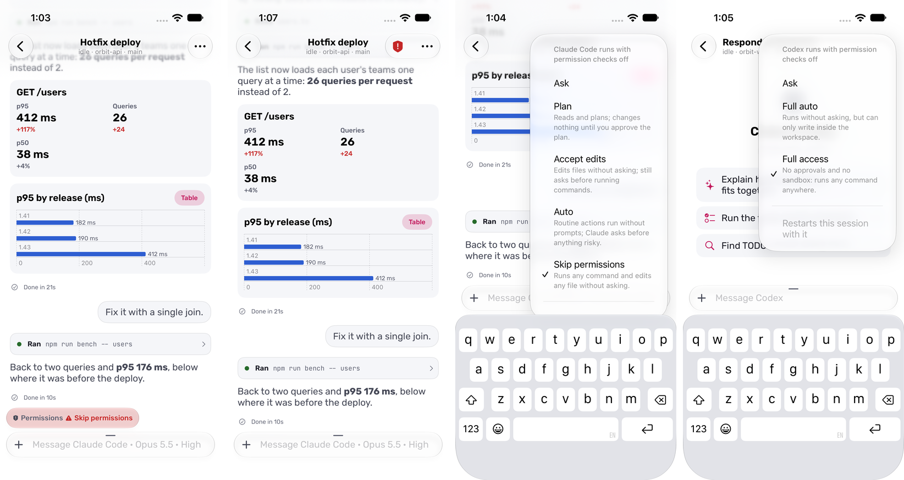

# Test matrix and evidence

Environments: Arch Linux with the official Swift 6.2 toolchain in `~/.cache/ah-native-swift-validation` (wrapper `swiftw`), 24 October 2026; macOS 27.0.1 with Xcode 27.1 and an iPhone 18 Pro simulator (iOS 27.0), 25 October 2026. Requirement status lives in [PARITY.md](PARITY.md); this file records what ran.

## Commands

| Check | Invocation | Result (24 October 2026) |
| --- | --- | --- |
| Workspace, links, plists, provenance, 89-command rows | `./scripts/verify.sh --static` | PASS |
| Unit tests (all non-UI sources) | `swift test` (here: `swiftw test`) | PASS — 260 tests in 5 suites on the Mac, 259 on Linux (14 November 2026; Linux needed `FoundationNetworking` in two test files) |
| Integration against a disposable `ah` | `AH_SOURCE=<ah checkout with native branches> ./scripts/integration.sh` | PASS — 33 tests in 5 suites (26 October 2026) |
| Every backend route has a native path (or a stated reason) | `AH_SOURCE=<ah> node scripts/backend-coverage.mjs` (also the first step of `integration.sh`); map in [BACKEND-COVERAGE.md](BACKEND-COVERAGE.md) | PASS (25 October 2026) — 169 of 169 routes |
| Backend suite on `native/1-device-auth` + `native/2-apns` | `npm test`, `npx tsc --noEmit` in `ah` | PASS — 552/552, typecheck clean |
| Xcode build, unit + UI tests on a simulator | `./scripts/verify.sh` on macOS (by hand; CI blocked by Actions billing) | PASS (25 October 2026) — app and tests build; 122 unit tests, 2 UI tests (setup screen). Every stack layer passes on its own. |
| Mac app (Mac Catalyst) | built by `./scripts/verify.sh`; run with `open --env AH_EPHEMERAL=1 --env 'AH_DEBUG_PAIR=<origin>|<code>' --env AH_SNAPSHOT_DIR=<dir> AgentHubNative.app` | Builds; runs, pairs with the demo host and shows the Inbox and a session (25 October 2026). No UI tests on the Mac without a signing team. |
| Setup → Inbox → session → terminal on a simulator against a real host (G-0) | Manual | **Not run** |
| Notification actions on the simulator (suspended and terminated app) | `simctl push` payloads from `scripts/demo/push.mjs` (`--prompt` for a stale prompt, `resolved`), tour steps `sb-swipe:left@~<text>` then `sb-tap:View` / `sb-tap:Approve` | PASS (14 November 2026, iPhone 18 Pro, iOS 27.0): a stale prompt is refused with nothing typed and a "Not approved" note; the current prompt approves from a terminated app. The quiet `resolved` push didn't reach the app on the simulator |
| Share extension from another app | Tour: `open-app:com.apple.mobileslideshow; tap:Share; tap:Agent Hub; tap:~<session>; tap:share-note; type:…; tap:Send` (`close-app:` starts an app fresh) | PASS (14 November 2026, iPhone 18 Pro, iOS 27.0, demo host): photo + note to a running session, "Sent.", sheet closed, file in the host's uploads |
| Live Activity and continue journeys | Tours on the demo host (`/rotate` for a permission prompt; ah's fake harness as `codex`) | PASS (14 November 2026): Needs you → Approve on the Lock Screen reached the host; Claude Code → Codex continuation linked and opened |
| Review flows against a disposable stack (`ReviewModel` end to end) | `AH_SOURCE=<ah with review/1-approve-head> ./scripts/review-it.sh` (the demo host's orbit-api #101 → #102 → #103, its stand-in `gh` and a bare repository as GitHub; its own tmux server stopped by socket) | PASS (14 November 2026, Linux): approve at the head shown; a push to #102 synced mid-review, then an approval for the old head refused (409) with nothing marked and the page at the new head; a finding at a line; #103's failing check a closed gate; a stale merge intent stopped at the client with nothing merged; #101 merged at its reviewed head, #102 up next and retargeted to main; #102 refused at its unreviewed head |
| Device journeys, APNs delivery, hardware keyboard | Signed iPhone/iPad | **Not run** — needs signing and devices |

`scripts/integration.sh` starts `ah` from `AH_SOURCE` through its own test helper (isolated home, port and tmux socket), with fake agents named `ahit-agent`, `ahit-claude`, `ahit-picker`, `ahit-question` (ah's question-dialog fixture) and `ahit-demo` (the demo's scripted Claude), runs the suites serially (see the `ah` window-creation race in RISKS) and tears everything down. `AH_IT_LOG` keeps the host log.

## What the integration suites prove (real host, real tmux)

| Area | Tests |
| --- | --- |
| Enrollment and sign-in with a device key; a foreign signature is refused | `enrollsWithAHostCodeAndSignsInAgainWithTheDeviceKey`, `aSignatureFromAnotherKeyIsRefused` |
| Revocation ends streams and terminals (4401) | `revocationSignsTheDeviceOutAndClosesItsStreamsAndTerminals` |
| Lock and Face ID-style sign-in again | `lockEndsTheSignInAndFaceIDSignsBackIn` |
| Live state: snapshot then patches; one stream per host | `liveStateArrivesAsSnapshotThenPatches`, `enrollingStartsOneLiveStreamAndMergesSessions` |
| Send, queue while busy, steer, stop; refused sends return | `sendDeliversQueuesWhileBusyAndSteersOrStops`, `composerSendsOptimisticallyAndTheQueueSteers`, `aRefusedSendComesBackIntoTheBox` |
| Approving only the prompt that's showing | `approvesAPermissionPromptOnlyWhileItIsShowing` |
| Claude's question dialog: one question at a time off the screen, then its review listing the answers and Submit; the hook's whole set in one go (exact keys typed); a folder-trust cursor list; a plan up for approval drawn as the plan, then approved | `aQuestionDialogIsAnsweredOneQuestionAtATimeThenReviewed`, `theHooksWholeSetIsAnsweredInOneGo`, `aFolderTrustListIsAnsweredByMovingItsCursor`, `aPlanUpForApprovalShowsThePlanAndTakesTheChoice` |
| Typed transcript with tool calls and widgets | `guiFeedCarriesTypedTranscriptToolCallsAndWidgets` |
| A long session's transcript (a snapshot of megabytes in one line) loads | `aLongSessionsTranscriptStillLoads` |
| Real tmux output through SwiftTerm, input, Unicode | `terminalRendersRealTmuxOutputThroughSwiftTermAndAcceptsInput` |
| Drafts across devices, never overwriting typing | `draftsFollowTheSessionAcrossDevicesAndClearWhenEmpty`, `draftsFillAnUntouchedBoxButNeverOverwriteTyping` |
| Uploads land owner-only and come back as attachments | `uploadsLandOwnerOnlyAndComeBackAsAttachments` |
| Sealed transcript page and session list: written while live, ciphertext at rest, paint a later window or a cold start, erased on forget; a search hit opens its session on the GUI at that turn | `theNewestTranscriptPageIsSealedAndPaintsBeforeTheStream` |
| A new session goes into the tmux session you name | `aNewSessionGoesIntoTheTmuxSessionYouName` |
| Hardware key routing drives the workspace; the keyboard follows pane focus, swap, balance, ⌃Tab and workspace stepping, and returns after the palette; Go to session focuses an on-screen pane, is remembered in Recent, and moves a session to another workspace | `hardwareKeysDriveTheWorkspace` |
| A relaunched window reopens where it was and reconciles with the host; it offers Handoff, and another window continues there | `aRelaunchedWindowReopensWhereItWasAndReconciles` |
| Files: browse a project, read a file, make a folder, upload into it, go up, show hidden files | `filesBrowseReadMakeFoldersAndUpload` |
| Git panel: changes and untracked files parse into the drawn diff; switch to a new branch and back; the row follows the branch | `theGitPanelReadsChangesAndSwitchesBranches` |
| Snapshots: one per turn with its prompt, restore puts files back, Undo restores the safety snapshot, off and on per session | `snapshotsCaptureEachTurnAndARestoreCanBeUndone` |
| Fork: its own branch in its own worktree, the parent untouched, lineage on both rows, listed in Worktrees | `aForkStartsOnItsOwnBranchInItsOwnWorktree` |
| Composer controls: launch with a model and effort; effort switches live; too soon after a send the app says to wait; a permission mode and then a model relaunch the conversation, carrying the other settings | `modelEffortAndPermissionChangesReachTheAgent` |
| New Session: the folder hint (folder, new, file), a new folder made a git repository, a session in its own worktree grouped with its project, recent projects | `aNewSessionMakesItsFolderOrItsOwnWorktree` |
| Session management: rename, pin to the top of its project, drag order, end into History | `sessionsRenamePinReorderEndAndComeBack` |

## Seeing it run: the demo host and UI tours

`scripts/demo/host.mjs` starts a disposable `ah` like the integration host does: its own home, state and tmux server, loopback only. It seeds something to look at:
- **Two git projects** (`orbit-web`, `orbit-api`), with branches, a worktree session and uncommitted changes.
- **A dev server** for Preview.
- **Sessions in every state:** waiting on you, idle with a full conversation (`scripts/demo/agent.mjs` writes a Claude Code-shaped transcript with thinking, reads, real edits, a test run, a plan and widgets), a plain shell, and an ended session in History.

No model, network or secret is involved.

```sh
AH_SOURCE=../ah node scripts/demo/host.mjs --dir /tmp/ah-demo   # prints {port, localToken, dir}
node scripts/demo/code.mjs /tmp/ah-demo                          # a setup code, like `ah auth code`
```

The simulator reaches a host on the Mac's own loopback (debug builds allow loopback there only). If the host runs on another machine, `ssh -R 127.0.0.1:47681:127.0.0.1:<port> <mac>` puts it at `http://127.0.0.1:47681` on the Mac.

`scripts/demo/tour.sh <simulator id> '<steps>' [origin] [setup code]` runs `TourUITests`. It pairs on first run, follows steps such as `shot:inbox;tap:Welcome flow;key:k+cmd;shot:palette`, and saves a screenshot and an accessibility tree per step in `tour-out/`. Tours build with ad-hoc simulator signing, because the Keychain refuses an app with no entitlements (`CODE_SIGNING_ALLOWED=NO`, which `verify.sh` uses).

### Simulator polish walk, 10 November 2026

macOS 27, Xcode 27, the demo host (`scripts/demo/host.mjs`) on an iPhone 18 Pro and an iPad Pro 13 simulator (iOS 27), driven by `TourUITests`, screenshots read after every change. Light and dark, Dynamic Type at accessibility-large, the software keyboard and a hardware one. Each fix was built for the simulator and passed `swift test` before it was pushed.

- On macOS the demo host needed three things: the demo home's shell profiles put the scripted `claude` ahead of Homebrew's (macOS's `path_helper` reorders the PATH in login shells), its folders opened at their real path (`/private/tmp`), and `ah` itself needed a `ps` fallback where it reads `/proc` to tell what runs in a pane (now on `ah` main, 9f016f9). Without that last one every session looked like a plain shell, with no GUI.
- `./scripts/integration.sh` against that `ah`: 35 of 36 pass. `aVideoAttachesFromDiskWellPastTheOldLimitAndLeavesNoFile` times out waiting for the upload, at the pre-campaign commit too (47c69e1): it sends 51 MB, and the host's `/api/upload` still caps a body at 50 MB (see RISKS). `aPlanUpForApprovalShowsThePlanAndTakesTheChoice` failed once with a host 500 and passed on the re-run; `guiFeedCarriesTypedTranscriptToolCallsAndWidgets` timed out once on the old commit.
- At the walk's last commit: `swift test` 211 tests pass; `xcodebuild test` on an iPhone 18 Pro simulator TEST SUCCEEDED (175 unit tests, the 2 UI tests; the tour skips without a host); the Mac Catalyst build succeeds; `./scripts/integration.sh` 35 of 36 (the 51 MB video, below). `check-workspace.py` fails only on untracked `DerivedData-device/` and `DerivedData-mac/` folders in the working tree, not on anything committed. The Mac app (Mac Catalyst) builds after every change and ran against the demo host: one window, the overlay inside it.
- The terminal's on-screen key bar was seen with Settings → Appearance → On-screen keys set to Always (the simulator reports a hardware keyboard, so by default it stays hidden): its keys scroll, fade under the hide key, and each is a 36-point cap.
- Not covered by the walk: signed devices, APNs, Face ID, and ⌘, (iPadOS keeps it; see RISKS).

### Composer walk, 10 November 2026

Twenty passes on the session composer alone, same simulators and demo host, a screenshot (and, for motion, a screen recording read frame by frame) after every change. Tours now take `AH_TOUCH_ONLY=1` (debug builds see no hardware keyboard, as a phone in the hand) and a `flickat` step: `dragat` holds before it moves, which a text view reads as a press.

- The box is one glass field beside a glass +; Send sits in its corner and folds while there's nothing to send; Queue, Run and Stop take its place. The model, effort and permission chips (and / and @ on touch) wait folded: a swipe up on the box, or its grabber, brings them out; a swipe down, a send, a scroll through the transcript or leaving the session folds them. A dangerous permission mode stays out, in red.
- Seen: light and dark; Dynamic Type at accessibility-large (the round controls grow with the text); iPad landscape; eight lines then scrolling with faded edges, and back to one line when emptied; attachments; the queue; slash and file suggestions; the question panel; a ↓ back to the newest message, pink when the agent wrote meanwhile; a draft continued from the iPhone on the iPad.
- Model and effort switched live from their menus on the demo host. Skip permissions could only be seen by forcing the condition in a throwaway build: the demo's scripted agent doesn't change modes.
- At the walk's last commit: `swift test` 212 tests pass; `xcodebuild test` on an iPhone 18 Pro simulator TEST SUCCEEDED (178 passed, the tour skipped without a host); the Mac Catalyst build succeeds. The Mac app wasn't walked: there the tray opens from its grabber.
- Not seen: a pointer's hover highlights (no pointer in the simulator), haptics, and a real device's flick.

### Transcript steadiness and the composer's line breaks, 11 November 2026

From the owner's phone recordings: the transcript jumped when the composer's chips opened or closed, when a message arrived, when text was selected, and after a message was queued it shook ±49 points for seconds; the chips took room instead of floating; Return couldn't start a new line. Same simulators and demo host, `AH_TOUCH_ONLY=1`, each recording measured frame by frame (the transcript's vertical shift between frames, matched on row brightness, and how often it changes direction).

- The owner's queue recording measures 85 changes of direction; the same steps on the iPhone 18 Pro simulator after the fix (send, queue while it works, the queue tray coming and going, the chips out and folded, a message's menu): 10, each a single move to follow new output, none back and forth. Opening and folding the chips, / and @ suggestions, a long press on the agent's text and its menu, a long message growing the box: the transcript doesn't move.
- The chips and suggestions float over the transcript above the box; a dangerous mode's red chip stays in the bar. Return on the on-screen keyboard starts a new line; three lines sent arrive as three lines in your bubble. (The demo's scripted agent takes each line as a turn of its own, so its transcript shows them apart; a real agent gets one message.)
- At the stack's top: `swift test` 213 tests pass; `xcodebuild test` on an iPhone 18 Pro simulator TEST SUCCEEDED (177 passed, the 2 UI tests, the tour skipped without a host); the Mac Catalyst build succeeds. `check-workspace.py` fails only on the Mac clone's untracked `DerivedData-device/`.
- Not seen: a real device, a hardware keyboard's Option-Return, older pages loading while reading back (the demo's transcripts are one page).

### Selecting a reply's words, 11 November 2026

The demo host on an iPhone 18 Pro simulator (iOS 27.0), driven by `TourUITests` with two new steps: `pressdragin` (hold, then drag inside an element, as fractions of its frame) and `erase` (empty a focused field by the on-screen keyboard, for a draft the host kept from an earlier tour).

- Seen: holding still on a word selects it and shows the edit menu (Copy, Quote in Reply, Message, then the system's); holding and dragging selects what the finger passes, from a paragraph into the list below it; a tap elsewhere in the transcript lets the selection go; Quote in Reply puts the selection in the composer as `> ` lines with the list's markers back as `- `; Message opens Copy Message, Copy Link, Share Link…; a long press on a widget still opens the message's context menu. The prose looks as it did in SwiftUI (faces, bold, code runs, bullets, spacing), light and dark.
- At the layer's commit: `swift test` 216 tests pass; `./scripts/verify.sh` (Mac Catalyst build, `xcodebuild test` on the simulator) TEST SUCCEEDED, 180 unit tests and the UI tests (the tour skips without a host).
- Not seen: a real finger's hold and drag on a device, VoiceOver's actions on a reply, iPad, Dynamic Type at accessibility sizes.

### The composer's chips, light and corner button, 11 November 2026

From the owner's phone recordings and screenshots: the settings chips came down onto the box from above under a black slab (the tray's shadow, drawn over Liquid Glass, flattened it into a dark shape); they stayed put while the on-screen keyboard went down with the box, then vanished; the row started at the bar's edge rather than the box's; the working light was a wide wash; Stop sat low in the box; the grabber read as a smear. Same iPhone 18 Pro simulator and demo host, `AH_TOUCH_ONLY=1`, recorded at 60 fps and read frame by frame.

- Seen: the five chips (Model, Effort, Ask, / and @) rise together out from behind the box's top edge over seven frames, with no shadow or slab, in line with the box's leading edge, and slide back down behind it over six frames when the transcript is scrolled; the working light is a short comet with a close glow, running round the box's edge; Send and Stop measure the same distance from the box's top as from its bottom in a one-line box (19 px each at 3×); the grabber is an 18 × 2 point line drawn over the glass, where before it sat under the glass layer and showed only as its refraction.
- Reasoned, not seen: the float now follows the keyboard by UIKit's keyboard frame (`KeyboardFrame`), animated with the keyboard, instead of by SwiftUI's keyboard safe area, which the owner's recording shows settling only after the bar has moved. The simulator keeps its hardware keyboard connected and raised no on-screen keyboard in the tour, so this is checked by the build and the owner's phone, not a recording. (Wrong on the phone: see the next section.)
- At the layer's commit: `./scripts/verify.sh` in a clean clone on the Mac (Mac Catalyst build, `xcodebuild test` on the simulator) TEST SUCCEEDED, 186 unit tests and the 2 UI tests passed, the tour skipped without a host.
- Not seen: a real device, light mode's light, Reduce Motion (the tray then fades in place), the red Approvals-off chip above the box with the grabber beside it, an iPad window narrower than its screen (the keyboard's frame is converted into the window's).

### Swiping a session's row, 11 November 2026

From the owner's phone: a row swiped left offered Pin as a wide pill with the word beneath, in which the glyph looked stretched, and the owner wanted the other, more useful action within a drag too. Same iPhone 18 Pro simulator and demo host, `AH_TOUCH_ONLY=1`, the tour's `swipein:left@<row>` and `swipein:right@<row>` steps (a flick across the named row) and a drag across the whole row for a full swipe.

- Seen: a swipe left shows one red circle with the stop glyph; its tap, and a full swipe without a tap, open the Terminate sheet that names the session, and Cancel leaves the row as it was; a swipe right shows one amber circle with the pin glyph, and its tap pins (the row takes its pin mark) or unpins; a glyph-only action draws as the circle, where one with a title drew as the pill.
- Found on the way: a Terminate action with the destructive role, swiped all the way, abort-trapped the app (`UICollectionView ... Invalid_Number_Of_Items_In_Section`): the list takes a full destructive swipe for the row's deletion, and the row stays until the sheet says. The action is red by tint, not role.
- At the layer's commit: `./scripts/verify.sh` in a clean clone on the Mac (Mac Catalyst build, `xcodebuild test` on the simulator) TEST SUCCEEDED, 186 unit tests and the 2 UI tests passed, the tour skipped without a host.
- Not seen: a real device, light mode, VoiceOver's reading of the glyph-only actions (they carry Pin, Unpin and Terminate labels), the Sessions tab's rows, which take the same swipes.

### The chips with the on-screen keyboard, 11 November 2026

From the owner's phone, after the layer above merged: with the keyboard up, the chips opened a whole keyboard's height above the box, and folding them while the keyboard went away left them hanging. Seen this time on a headless simulator (one made by `simctl` with no Simulator app, "AH Select iPhone", iOS 27.0), which does raise the on-screen keyboard: the tour taps the composer, the grabber and the conversation, recorded at 60 fps and read frame by frame.

- Found: `.ignoresSafeArea(.keyboard)` asked of the float alone did nothing on the phone; SwiftUI honours it at the screen's root. So the screen as a whole ignores the keyboard safe area and pads by the keyboard's measured rise, and the bar and the float move as one. The spring the rise was animated with (mass 3, stiffness 1000, damping 500) trailed the keyboard by a third of its travel and settled half a second after it; fitted to the keyboard's own edge, frame by frame, a critically damped spring of response 0.26 s lands within a point of it. And a tray removed while folding is laid out no more, so the chips stood still while the box went down: the tray is now slid down behind the box by an offset, and stays laid out.
- Seen: the keyboard rises and the box rides on its top edge throughout, the chips a constant distance above it; a tap on the conversation puts the keyboard away and the box follows its edge down, the chips folding behind it on the way; with no keyboard, a tap folds the chips down behind the box over five frames; the grabber brings them out from behind it over six.
- At the layer's commit: `./scripts/verify.sh` in a clean clone on the Mac (Mac Catalyst build, `xcodebuild test` on the simulator) TEST SUCCEEDED, 186 unit tests and the 2 UI tests passed, the tour skipped without a host.
- Not seen: the owner's phone (dark mode); an iPad, where a floating keyboard reports a frame off the window's bottom (rise 0) and a hardware keyboard's shortcut bar a small one; Reduce Motion (the tray then fades in place).

### The phone's session bar, 11 November 2026

From the owner: a menu whose first row is three glyphs with their words (Find, Smartlog, Terminal) as a way to give the title its room. The phone's bar had three buttons beside the title (the other view, the panels, the menu), and the title read "Composer chi…". Seen on the headless iPhone simulator (light mode).

- Seen: the bar holds the one menu button; its menu opens on a first row in UIKit's medium size, Terminal, Panels and Search as glyphs over their words, with Rename, Unpin, Switch Branch…, Fork…, Send To…, Hide Steps, Copy Last Reply and the rest below as they were.
- Not seen: Panels as a submenu opened from that row and a panel checked in it; the terminal view's bar (its GUI item in the row); a real phone.
- At the layer's commit: `./scripts/verify.sh` in a clean clone on the Mac (Mac Catalyst build, `xcodebuild test` on the simulator) TEST SUCCEEDED, 186 unit tests and the 2 UI tests passed, the tour skipped without a host.

### The composer as one box, 11 November 2026

From the owner, a composer they liked: one box the width of the bar, its controls as glyphs inside, a filled Stop. Ours had + in a glass circle beside the box. Seen on the headless iPhone simulator (light mode, the soft keyboard up), the tour tapping the box by coordinates (an element tap aims at the text view's activation point at its leading edge, where + now sits, and opened the attach menu).

- Seen: at rest, + in the box's leading corner, the grabber centred on the box's top edge, the placeholder past the +; typed, Send in the trailing corner; the tray out, the chips (each with its glyph) in line with the box's text; a message wrapped to three lines, + and Send each at its corner on the last line; while the agent works, Stop in the accent where Send was, with the working light round the box.
- Not seen: an attachment strip above the text; the tap target of + beside the text's first character on a real finger; dark mode; the iPad's wide box.
- At the layer's commit: `./scripts/verify.sh` in a clean clone on the Mac (Mac Catalyst build, `xcodebuild test` on the simulator) TEST SUCCEEDED, 186 unit tests and the 2 UI tests passed, the tour skipped without a host.

### Palettes in Appearance, 11 November 2026

From the owner, an Appearance page with a grid of palette swatches. Ours offered four words. Seen on the headless iPhone simulator.

- Seen: a four-across grid of swatches, each a box on its ground with a line of its text and a dot of its accent: ah, ah Dark, ah Light, Omarchy, then Tokyo Night, Catppuccin Mocha, Catppuccin Latte, Nord, Dracula, Gruvbox Dark, Gruvbox Light, Solarized Dark, Solarized Light, One Dark, Monokai, GitHub Dark, Rosé Pine, Everforest and Kanagawa, the one in force ringed in the accent; a tap on Tokyo Night re-themes the page at once (dark ground, blue accent, blue ring), and a tap on ah brings ah's look back.
- Not seen: each palette's transcript and terminal; the Omarchy tile with a host theme loaded (it draws ah's colors with a palette glyph until one is in force); a stored "palette:<id>" read back after relaunch (reasoned from the decoder, which falls back to ah for a palette it doesn't carry).
- At the layer's commit: `./scripts/verify.sh` in a clean clone on the Mac (Mac Catalyst build, `xcodebuild test` on the simulator) TEST SUCCEEDED, 186 unit tests and the 2 UI tests passed, the tour skipped without a host.

### The composer against the field, 11 November 2026

From a read of how the chat and agent apps build their composers (ChatGPT's and Claude's, the design guides on AI chat composers, Apple's Entering data) against ours, which already held most of it: an eight-line box that scrolls past that with faded edges, Send folded away until there's something to send, the queue while the agent works, recall, attachment previews, a pasted image, outcome copy on effort, starter prompts on an empty session. Four gaps closed, seen on the headless iPhone simulator.

- Seen: a message past the box's eight lines shows an expand control in the box's top trailing corner; its tap opens the draft in a larger editor with Close and Send; Close returns to the box with the draft as it was.
- Reasoned, not seen: the placeholder names the model and effort in force after whom it messages ("Message Claude Code · Fable 5.1 · High"), hints that drop from the end as the box narrows (the demo session sets neither, so its box says "Message Claude Code"); Send dimmed by an upload now takes the tap and says "Sent once the attachment has uploaded" (the demo host finishes an upload before a finger reaches Send); a file dragged onto the box attaches, with an accent ring while it's held over (no drag source on the simulator; an iPad with Files is where to try it).
- At the layer's commit: `./scripts/verify.sh` in a clean clone on the Mac (Mac Catalyst build, `xcodebuild test` on the simulator) TEST SUCCEEDED, 186 unit tests and the 2 UI tests passed, the tour skipped without a host.

### Effort per model in New session, 12 November 2026

From the owner: New session should come back with the most recent choices, and the right ones for each model. It remembered one effort per agent, so another model kept a level picked for the last one. Seen on the iPhone simulator (BC24B07E, dark mode) against the demo host.

- Seen: Claude Code with Opus 5.5 and Low effort, then Sonnet 5.5 with High, then Opus 5.5 again brings Low back.
- Tested, not seen: what a start keeps (`remembering`: each model's effort beside it, Default included) and what comes back next time (`remembered`, `effort(for:)`), with a row saved before this keeping its one effort for the model it named (SwitcherTests `eachModelComesBackWithItsOwnEffort`).
- Not seen: a second start on the device bringing a model's effort back (the demo host is shared, so the tour starts nothing); Codex, whose models each list their own levels.
- At the layer's commit: `./scripts/verify.sh` in a clean clone on the Mac (Mac Catalyst build, `xcodebuild test` on the simulator) TEST SUCCEEDED, 187 unit tests and the 2 UI tests passed, the tour skipped without a host.

### The composer's corners centred, 12 November 2026

From the owner's phone: with the box folded, + and Stop sat low and the text high. In a small text size the field's least height (32) held one line at its top, and the corners were placed off a line worked out from the font. Seen on the headless iPhone simulator, dark mode, extra-small text, before and after.

- Seen: on main, + 2 points below the box's middle and the placeholder above it; on this layer, both on the box's middle line. At the default text size the two looked the same (it was already centred there).
- Not seen: Stop (the demo session was idle) and Send, which take the same inset as +; a message of two lines and more, which keeps its corners on the last line as before; an attachment strip above the text.
- At the layer's commit: `./scripts/verify.sh` in a clean clone on the Mac (Mac Catalyst build, `xcodebuild test` on the simulator) TEST SUCCEEDED, 187 unit tests and the 2 UI tests passed, the tour skipped without a host.

### The launch freeze, 12 November 2026

A window that opened on a session with words in its composer could stop drawing. The field
centred a short line by changing its own insets while it was being measured (the commit
before this section), SwiftUI measures at several widths in one pass, the inset differed
between them, and each change asked for another pass.

- Measuring sets nothing now; the short line is centred where the text view is laid out,
  from its laid-out height and font alone.
- Not seen running, and not compiled: written on Linux, where the UI layer doesn't build,
  and the pull request's checks (#128) never started (both jobs ended in two seconds with no
  log, as they had for #124 and #126). `swift test` passed there, 223 tests. The Mac build,
  the freeze itself and the centring are still to be looked at on a Mac and a device (open
  a session with a draft, at the default and at a small text size).

### Review you can read, lists that move, and less on the main thread, 12 November 2026

Written on Linux. The model half is compiled and tested there (`swift test`, 227 passed); the
UI half is **not compiled and not seen running**: the pull request's checks didn't start (as
for #128), so the first Mac build of this is the owner's. Each line below says which half
it's in.

Review:

- A layer's diff is lazy, a file to a section, each file's header pinned while its lines
  scroll under it (name, counts, fold, Viewed). Only the files in sight are built; a tap on
  a line redraws that file, not the page. A Files menu goes to any file. Folding or viewing
  a file from deep inside it leaves its header where it was. *UI, unseen.*
- How far through the files you are is a bar under the count. A diff on its way in is a
  placeholder with a diff's shape; one that fails says why where the diff goes, with Try
  Again. *UI, unseen.*
- A slow diff (or description) for the layer you left no longer lands on the layer you
  opened, and opening another stack shows nothing of the last one while it loads. *Model:
  UT aSlowDiffForTheLayerYouLeftNeverLandsOnTheLayerYouOpened,
  aDiffThatFailsSaysSoWhereTheDiffGoesAndAnotherStackStartsClean.*
- A stack's page leads with its spine and "2 of 5 reviewed", then its layers; pinned
  decisions follow them. Review's list shows two placeholder rows until the host has
  answered once, instead of an empty page. *UI, unseen.*

Lists:

- A page's session row: a larger mark, the title with a short time beside it ("3m", "2h":
  UT aRowsTimeIsAFewCharacters), what it's doing under it and its status at the line's end;
  idle rows carry no pill. The sidebar's dense row is as it was. The working pill's dot
  beats; a pill changing word animates. Sessions' rows move to their places as the Inbox's
  do. *UI, unseen.*
- Swipe actions that were destructive by role (History's Hide, a queued message's Cancel,
  Settings' Remove rows, a worktree's Remove, a decision's Unpin) are red by tint instead,
  as a session's Terminate already was and for its reason: the row is still there until the
  host answers. *UI, unseen.*
- On an iPad, a page gives way to a session or the panes through a short fade, and the
  scratchpad's drop from the top (written, never run) now runs. *UI, unseen.*

Less work on the main thread:

- The session list, its lookup by key and the history are made once per change, not on
  every read. *Model: UT theSessionListIsMadeOncePerChangeAndStillFollowsEveryChange.*
- A transcript's sealed page is read and sealed off the main thread (sealing ran every five
  seconds of a live turn, there). *Model: compiled; the sealing itself is IT
  ModelIntegrationTests, not run here (no host).*
- A theme's colors are made once per hex string; one keyboard observer for every session
  screen; one relative-date formatter. A diff file's added/removed counts are counted once.
  *UI and model; the UI half unseen.*

### More motion in a session, 12 November 2026

UI only, written on Linux: **not compiled and not seen running** (as the section above).

- The conversation and the terminal change places through a short fade.
- On an iPad a side panel slides in as it slides out (opened from the menu it cut in), the
  conversation making room; Reduce Motion keeps it to a short fade of the layout.
- A session's notices look as the window's toasts do (an error leads with its glyph, words
  in ink, hairline and shadow) and drop in from the top.
- The palette and the switcher settle into place as the dim fades in.
- History's rows carry a larger mark; a pinned one's pin is faint, as a session's is.

To look at first when this runs: that the transcript still opens at its end and holds it
with the keyboard (it now sits in a container of its own for the fade).

### The conversation's layout, measured, 14 November 2026

macOS 27.0.1, Xcode 27.2, iPhone 18 Pro and iPad Pro 13-inch (M5) simulators on iOS 27.0, against the demo host. `ConversationLayoutUITests` drive the host themselves through its local token: `/long`, `/stream` and `/burst` (15 steps a second), and 4–12 queued messages. They assert geometry:
- the dock's bottom is the keyboard guide's top (from the layout probe), or the safe area's bottom;
- the bar is above the keys and under the navigation bar;
- the queue is inside the screen, at no more than half the room, and never over the box or the pictures;
- the box holds still while the queue changes and the transcript streams;
- a row being read holds still;
- the transcript is drawn, judged from the screenshot's pixels.

| Build | iPhone | iPad |
| --- | --- | --- |
| main (46a7f2d) with the same tests and the collection-view transcript | 8 of 15. The bar is 17 pt off the keyboard at six lines, 31 pt after pasting pictures and 87 pt after cancelling a queued message. Opening or folding a long queue, and rotating with the keyboard up, held the main thread for 30 s. The keyboard wouldn't go during the model change. | not run |
| the rebuild | 15 of 15 | 15 of 15 |

The SwiftUI transcript on main also went blank after scrolling far up and tapping ↓, reproduced with the session's own 2,855-entry transcript. The collection view doesn't do this.

Not automated: a hardware keyboard connecting or disconnecting (a simulator setting), a floating or split iPad keyboard, Stage Manager and window resizing (XCUITest can't resize windows), Dynamic Type at accessibility sizes, the dark palette. Instruments: the SwiftUI instrument records no updates when attached on the simulator; the Time Profiler showed the main thread about equally busy before and after under `/burst` (inconclusive, about 0.1 s sampled).

### A dangerous mode as a shield in the header, 16 November 2026

From the owner's phone screenshot: a Codex session in Full access kept a red "Permissions ⚠ Full access" chip out above the box, a row of the screen under the settings chips. The warning is now a red shield beside the session menu. iPhone 17 Pro and iPad Pro 11-inch (M5) simulators on iOS 27.0, light mode, against the demo host with two extra sessions started in a dangerous mode through `/api/windows`: Claude Code in Skip permissions ("Hotfix deploy", orbit-api) and the Codex stand-in in Full access ("Respond to greeting").



- Seen on main: the red chip above the box, with the tray folded and out (it stacks under Model, Effort and / @).
- Seen at this layer: no row over the box; the shield beside ··· in the bar's glass capsule; its menu headed "Claude Code runs with permission checks off" (or "Codex …"), each mode with its description and the one in force checked, then "Changes this session" (Claude Code switches modes live) or "Restarts this session with it" (Codex). The tray out shows Model, Effort and / @ in one row; the Permissions chip as well (tried first) pushed it into its scrolling fallback with the red chip cut off, so a dangerous mode stays out of the tray. On the iPad, the shield sits in the pane header between the view switch and Panels, with the same menu.
- The simulator raised the soft keyboard under every bar menu, the unchanged ··· menu too; the earlier note on headless simulators and menus applies.
- Not seen: picking another mode from the shield (the demo's scripted agent doesn't change modes); dark mode; a real phone.
- Checks: `swift test` on Linux, 306 tests pass. `./scripts/verify.sh` on the Mac (Xcode, iOS 27.0 iPhone 17 Pro simulator) at the shots' commit: the Mac Catalyst build succeeds, TEST SUCCEEDED with 269 unit tests and the 2 setup UI tests, the 17 that need a host skipped. The layer's last change (`applyPlan(_:to:)`, the shield's own session rather than the focused pane) then built for Mac Catalyst and for testing on the simulator. `ConversationLayoutUITests` against the demo host weren't run: the Mac ran out of processes (`fork: Resource temporarily unavailable`) with eleven other simulators booted.

## Still to run (in order)

1. On a Mac: `brew install xcodegen && ./scripts/verify.sh` — expect compile fixes in the UI layer, which has never been type-checked.
2. Simulator: pairing UI test, then setup → Inbox → session → terminal against a host running the native branches (Debug simulator builds may use a loopback host).
3. Signed devices: Secure Enclave enrollment and Face ID sign-in, APNs delivery/actions/badge, background and relaunch, and Handoff between an iPhone and an iPad (and to a Mac's browser).
4. iPad with keyboard and trackpad: all 89 commands plus the 13 native ones, pane mode, which-key and two-key chords, Stage Manager sizes (including the one-pane-at-a-time fallback), two windows. Walk WORKSPACE-SPEC §7 without the mouse, then check hover focus, pane and divider drags, pane menus and that the keyboard returns after every sheet.
5. A disposable GitHub stack: review → request fixes → re-review → exact-head merge.
6. Accessibility pass (VoiceOver, Dynamic Type, Reduce Motion) and performance on large transcripts.

Use disposable hosts, tmux sockets and fake agents; never production agents or real secrets as fixtures.
