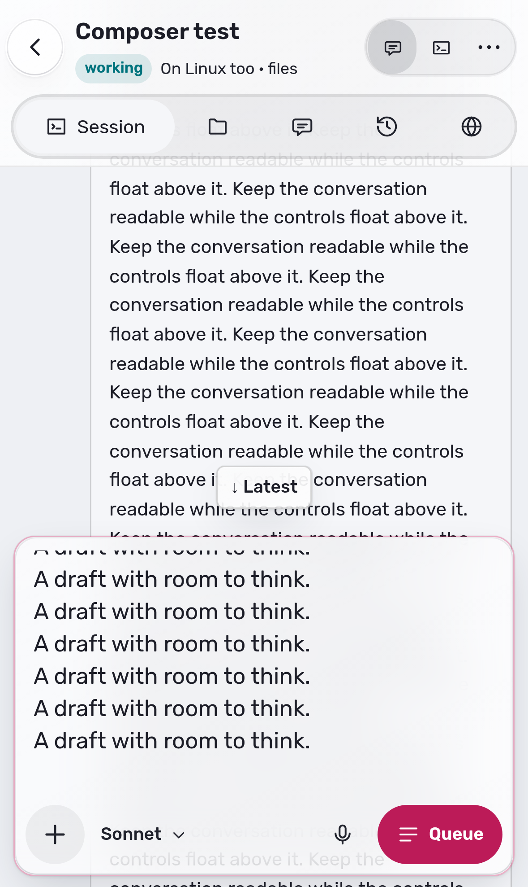
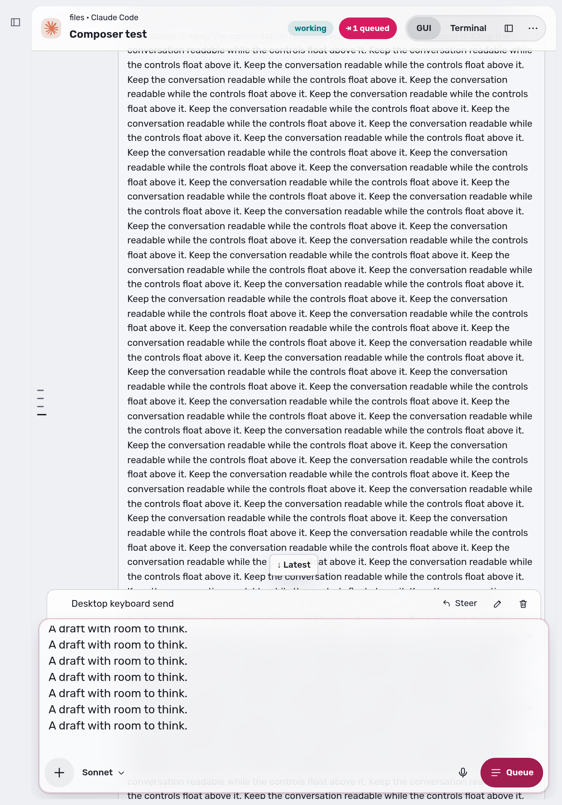

# Mobile web and native-client release — 26 October 2026

The hub supports the native iPhone/iPad app and the updated mobile web conversation in one build. The server remains on loopback behind Tailscale Serve; the existing web client and CLI remain supported.

## Included behavior

- Native device-key enrollment/sign-in, bearer sessions, device management and revocation. Originless writes and terminal upgrades require native authorization without ambient cookies; browser Origin/CSRF checks remain in force.
- Native authenticated REST, state/feed streaming and terminal traffic; short-lived preview cookies end with their parent native sign-in.
- APNs registration and delivery support alongside Web Push, including approval and finished-session reply categories. Apple credentials and a push-capable signing team are still required; this host currently reports APNs unconfigured.
- Phone/iPad conversation chrome and composer float above the actual transcript. Measured scroll insets keep first/last messages and Latest reachable while drafts grow or the keyboard changes the viewport. Session settings use a touch sheet; desktop keyboard controls remain available.
- Browser suites run serially and prefer the Chromium revision matched to Playwright. CI installs that revision instead of depending on its system Chrome version.

## Verification

- The native-auth layer passed typecheck, production build and all 543 tests.
- The native-push layer passed typecheck, production build and all 552 tests, including APNs provider-gateway fixtures and adversarial native/browser authorization tests.
- The final combined release passed typecheck, production build and a fresh full regression run: **552 passed, 0 failed/skipped/cancelled**.
- The actual portable Swift client from `ah-native` at `10b09a4` compiled with Swift 6.2 and passed all **33 integration tests in five suites** against this release's disposable backend. These cover enrollment/sign-in, snapshot/patch SSE, transcript streaming, real SwiftTerm/tmux input, sending/queueing/answers, previews, files, host administration, restoration and revocation.
- The native client's backend-coverage check accounted for all **169 routes**, with no uncovered route.
- All **43 browser tests passed**, with no skipped or cancelled tests, using Playwright Chromium 156.0.8078.4. They cover mobile composer flows, real backdrop pixels, scrolling/keyboard geometry and the existing desktop/phone/iPad smoke workflows. Screenshots below show disposable fixture data.
- Production dependency audit: no known vulnerabilities.

The local `/tmp` quota and an older system Chromium caused earlier browser capture/crash failures. The successful browser run used a private disk-backed TMPDIR and the matching Playwright browser. No test assertion was removed to make it pass.

GitHub Actions is blocked by account billing/spending limits, with jobs failing before any step runs. The checks above were executed locally. No physical iPhone/iPad, iOS UI rebuild, Safari/PWA inspection or real APNs delivery was performed for this host release.

## Screenshots

Phone:

iPad:

## Update procedure

Merge the native-auth, native-push and mobile-UI PR stack to main; fast-forward the host checkout, install from the frozen lockfile and rebuild the web bundle. Remove the temporary native-worktree systemd override, reload the user service configuration and restart `ah.service` only. Keep `ah-tmux.service` running. Validate the served bundle, native sign-in route, authorization and live session continuity after restart.

Use `AH_SOURCE=../ah ./scripts/integration.sh --jobs 2` from the sibling native repository to reproduce the client/backend integration checks. On Linux, set `SWIFT` to the installed toolchain wrapper when it is not on PATH. `pnpm exec playwright-core install chromium` installs the matched local browser; `pnpm test:ui` runs the browser checks. If the machine's temporary filesystem is full or quota-limited, set TMPDIR to a private directory on a filesystem with space.
